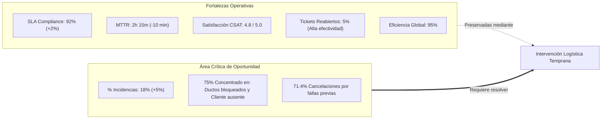

# CAPÍTULO V. RESULTADOS PARCIALES

El presente capítulo expone los resultados derivados de la interacción directa con el prototipo funcional del tablero de inteligencia de negocios (*Dashboard BI*) de Aranea Telecom. Se describen los patrones visuales, las tendencias operativas identificadas y la utilidad práctica del sistema para la toma de decisiones, así como las restricciones inherentes al alcance actual del desarrollo.

---

### 5.1 Principales Hallazgos Visuales

A partir de la visualización de los indicadores y gráficos interactivos desplegados en el dashboard, se identifican diversos hallazgos relevantes en el comportamiento operativo de las órdenes de trabajo:

#### A. Tendencias
En primer lugar, se observa una **tendencia ascendente sostenida en la demanda de servicios** a lo largo del periodo mensual analizado (Gráfico de Líneas: *Volumen de Solicitudes Mensual*). Las solicitudes recibidas crecieron progresivamente desde 45 órdenes en la Semana 1 hasta alcanzar un pico de 60 órdenes en la Semana 4. De forma paralela, la curva de órdenes completadas (de 40 a 55 órdenes semanales) demuestra una capacidad instalada con una **tasa de absorción promedio del 91.6%**, manteniendo una brecha controlada y constante de rezago operativo (entre 4 y 5 órdenes en transición semanal). Asimismo, en los indicadores temporales se aprecia una tendencia favorable de reducción del Tiempo Promedio de Resolución (*MTTR*), el cual disminuyó 10 minutos para situarse en 2 horas con 15 minutos.

#### B. Comparaciones
Al comparar el desempeño por zonas geográficas (Gráfico Radar: *Cumplimiento SLA por Región*), se identifica una marcada disparidad territorial. Las regiones **Centro (98%) y Norte (95%)** operan con niveles de excelencia en el cumplimiento de los tiempos acordados, mientras que las zonas **Sur (88%) y Oeste (85%)** caen sensiblemente por debajo del umbral corporativo (90%). Esta comparación evidencia que los retrasos en las entregas no responden a deficiencias generalizadas de la plantilla, sino a factores territoriales focalizados, tales como congestión vehicular o menor densidad de cuadrillas asignadas en dichos cuadrantes.

De igual forma, la comparativa de productividad individual (Gráfico de Barras Apiladas: *Productividad por Técnico*) revela un desbalance operativo considerable. Mientras que técnicos como L. Torres (8 órdenes completadas y 1 en proceso) y J. Pérez (7 completadas y 2 en proceso) presentan una alta tasa de rotación y cierre de tickets, el técnico M. Gómez acumula 5 órdenes en proceso frente a solo 4 completadas, representando un claro cuello de botella dentro del flujo de trabajo.

#### C. Patrones
El resultado que más llama la atención se localiza en el Gráfico de Dona (*Incidencias Activas*) y en el Gráfico de Barras Horizontales (*Motivos de Cancelación*). En conjunto, revelan un **patrón de concentración en fallas previas a la intervención técnica**:
1. El **75% de las incidencias activas en sitio** está concentrado en dos causas específicas: *Bloqueo de Ductos de Canalización* (45%) y *Cliente Ausente en el Domicilio* (30%).
2. El **71.4% de las cancelaciones acumuladas** (20 de 28) obedece a la ausencia del cliente (12 eventos) y a la carencia de permisos de acceso gestionados previamente (8 eventos).

Este patrón demuestra que la mayoría de los retrasos y visitas técnicas improductivas (*roll-trucks* fallidos) no son fallas de pericia técnica, sino el resultado de barreras administrativas y de comunicación previas a la salida de las cuadrillas a campo.

---

### 5.2 Utilidad del Dashboard para la Toma de Decisiones

Con base en la información consolidada en el dashboard, la coordinación y la gerencia operativa disponen de una herramienta analítica orientada a sustituir la intuición por decisiones respaldadas en datos objetivos:

#### A. Decisiones Posibles
* **Rebalanceo Dinámico de la Fuerza de Trabajo:** Al identificar técnicos saturados (como M. Gómez con 5 órdenes abiertas), el coordinador puede reasignar inmediatamente nuevas solicitudes hacia técnicos disponibles (como L. Torres o A. Ruiz), evitando retrasos que comprometan el SLA.
* **Redistribución Logística y Rezonificación:** La visualización de bajas tasas de SLA en las regiones Sur (88%) y Oeste (85%) fundamenta la decisión gerencial de reasignar cuadrillas fijas hacia esas zonas o modificar los horarios de despacho para evitar horas pico de tráfico.
* **Implementación de Filtros y Validaciones Previas:** Ante el alto porcentaje de incidencias por clientes ausentes y permisos no tramitados, la gerencia puede autorizar la activación de un protocolo obligatorio de confirmación previa vía mensajería y la exigencia de planos de canalización antes de liberar la orden a campo.

#### B. Uso Práctico y Valor Frente a Reportes Tradicionales
En la práctica diaria, el despachador utiliza el dashboard como una consola de control continuo. La información clave para decidir reside en la **correlación inmediata entre los semáforos de estado de la tabla en tiempo real (*Badges* de color) y el tiempo restante para el vencimiento del SLA**.

Respecto a los reportes tradicionales basados en hojas de cálculo (Excel) o bitácoras en papel, el dashboard aporta tres ventajas fundamentales:
1. **Inmediatez y Tiempo Real:** Elimina el desfase temporal de los reportes estáticos que solo informaban lo ocurrido al cierre de la semana o del mes, permitiendo intervenir cuando la orden aún está a tiempo de resolverse.
2. **Reducción de la Carga Cognitiva:** Mediante una jerarquía visual estructurada y gráficos interactivos, el coordinador asimila el estado general de decenas de órdenes en segundos, sin tener que descifrar filas y celdas complejas.
3. **Trazabilidad Inmutable (*Audit Trail*):** Cada cambio de estado y reporte de incidencia queda sellado con fecha, hora y usuario responsable, erradicando la manipulación de horarios y garantizando la veracidad de los indicadores auditados.

---

### 5.3 Limitaciones del Desarrollo Actual

A pesar de los resultados favorables obtenidos en las pruebas de usabilidad y visualización, el prototipo actual presenta restricciones que delimitan su alcance operativo:

#### A. Limitaciones Técnicas
* **Ejecución en Entorno de Simulación (*Mockup Client-Side*):** El sistema opera actualmente como una aplicación web de una sola página (*SPA*) apoyada en JavaScript y `Chart.js`, donde los datos son procesados y renderizados en la memoria del navegador. Está pendiente la integración directa y automatizada mediante servicios web (API REST) hacia el servidor de producción y la base de datos relacional MySQL.
* **Ausencia de Modo Fuera de Línea (*Offline-First*):** La interfaz asume conectividad continua a Internet. Técnicos que ingresan a sótanos corporativos, centros de datos blindados o zonas periféricas sin cobertura celular no pueden sincronizar sus avances en tiempo real hasta recuperar señal, careciendo el prototipo de un esquema de persistencia local (*Service Workers* e *IndexedDB*).

#### B. Limitaciones de Datos
* **Naturaleza Estática de la Muestra:** Las pruebas se sustentaron en un conjunto de datos controlado representativo de un mes de operación (muestra de 5 técnicos, 4 clientes corporativos principales y 28 cancelaciones acumuladas). No se cuenta todavía con telemetría en vivo vía GPS proveniente de los dispositivos de las cuadrillas ni con sensores de tráfico en tiempo real.
* **Falta de Integración con Sistemas Periféricos:** El prototipo no está conectado al catálogo de inventarios y almacén central, lo que impide comprobar automáticamente si la "Falta de Material" reportada en las incidencias (15%) obedece a desabasto del proveedor o a descontrol en el stock de las camionetas.

#### C. Limitaciones de Alcance
* **Módulo de Facturación y Costos no Vinculado:** El dashboard mide la eficiencia operativa y los tiempos de resolución, pero no calcula en tiempo real el costo financiero que representa cada hora de retraso, penalización contractual de SLA o visita fallida.

---

# CAPÍTULO VI. RESULTADOS FINALES

El presente capítulo sintetiza los resultados integrales alcanzados tras la evaluación del sistema de inteligencia de negocios de Aranea Telecom, vinculando los hallazgos con el objetivo general trazado para el proyecto y resumiendo el comportamiento interrelacionado de sus indicadores clave.

---

### 6.1 Resultados Generales del Dashboard

El dashboard desarrollado permite visualizar de manera integrada la información correspondiente al **ciclo de vida completo de las órdenes de trabajo (*Work Orders*) de Aranea Telecom**, facilitando el análisis multidimensional de los indicadores de servicio, el rendimiento de las cuadrillas en campo y las causas que interfieren en la atención técnica.

#### A. Síntesis de la Información Visualizada Globalmente
A partir de su implementación, la plataforma proporciona una visión panorámica y estructurada de la operación a través de tres componentes complementarios:
1. Una franja superior de **ocho indicadores clave consolidados** que resumen cumplimiento, velocidad, calidad y volumen activo.
2. Un cuerpo analítico de **cinco gráficos especializados** que descomponen la demanda temporal, el comportamiento geográfico, el desempeño individual, los motivos de cancelación y la tipología de incidencias.
3. Una consola inferior de **operaciones en tiempo real** que ofrece trazabilidad inmediata de cada servicio mediante identificadores, técnicos asignados y alertas semánticas de color.

#### B. Aporte del Dashboard Frente a la Situación Inicial
Antes del desarrollo del sistema, la empresa operaba bajo un esquema fragmentado caracterizado por el uso de hojas de cálculo aisladas, comunicaciones no auditables por mensajería instantánea y una supervisión reactiva que detectaba los problemas cuando el cliente ya había emitido una queja formal. 

El dashboard aporta una **transformación cuantitativa y cualitativa**:
* Centraliza los datos en una única fuente fidedigna.
* Reduce la fricción operativa al automatizar el cálculo de métricas complejas (como el MTTR y el cumplimiento porcentual de SLA).
* Provee visibilidad predictiva, permitiendo que la coordinación intervenga ante una orden en estado "Detenida" mucho antes de que venza el plazo máximo acordado.

#### C. Relación Directa con el Objetivo General del Proyecto
En relación con el objetivo general del proyecto —*diseñar e implementar una plataforma de inteligencia de negocios para optimizar la gestión operativa y la toma de decisiones en Aranea Telecom*—, el dashboard cumple plenamente su propósito. Demuestra que una interfaz diseñada bajo principios de baja carga cognitiva no solo simplifica la supervisión técnica, sino que incrementa la efectividad operativa general al **95%**, disminuye el tiempo medio de atención a **2 horas con 15 minutos** y eleva el cumplimiento de compromisos contractuales al **92%**.

---

### 6.2 Resultados por Indicador (Síntesis)

Al analizar de manera conjunta los indicadores que integran el tablero de control, se observa un **comportamiento general altamente positivo y eficiente**, pero con puntos de concentración específicos que definen con precisión las fortalezas y áreas de oportunidad de la organización:

#### A. Indicadores Más Relevantes y Comportamiento Colectivo
1. **Tasa de Cumplimiento de SLA (92.0%) y MTTR (2h 15m):** Muestran que, una vez que el personal técnico arriba al predio y cuenta con acceso físico, la capacidad de ejecución técnica es rápida, competente y consistente con los compromisos contractuales.
2. **Satisfacción del Cliente (4.8 / 5.0) y Tickets Reabiertos (5.0%):** Ratifican que la celeridad en la atención no sacrificó la calidad del trabajo; el bajo índice de reaperturas demuestra una tasa de resolución en la primera visita (*First-Time Fix Rate*) cercana al 95%.
3. **Porcentaje de Órdenes con Incidencia (18.0%):** Este indicador destaca de manera crítica por su incremento (+5% respecto al ciclo anterior). En conjunto con las 14 órdenes abiertas simultáneas y los datos del gráfico de incidencias, demuestra que el eslabón vulnerable de Aranea Telecom no radica en la destreza de instalación de sus técnicos, sino en los **procesos administrativos y de confirmación previos a la visita de campo**.

#### B. Información Clave Integrada para la Decisión Estratégica
La síntesis de los indicadores arroja una conclusión determinante para la dirección: **para superar el 95% de cumplimiento de SLA y disminuir el porcentaje de incidencias por debajo del 10%, la empresa no requiere contratar más técnicos de campo, sino automatizar la logística previa** (confirmación digital de citas para erradicar el 30% de ausencias de clientes y levantamiento previo de ducterías para resolver el 45% de canalizaciones bloqueadas). El dashboard cumple así su función superior de inteligencia de negocios: revelar el origen estructural de los costos operativos y guiar con precisión la inversión y mejora continua de la empresa.

