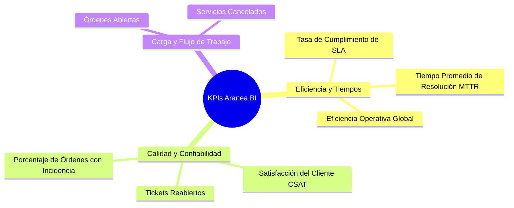
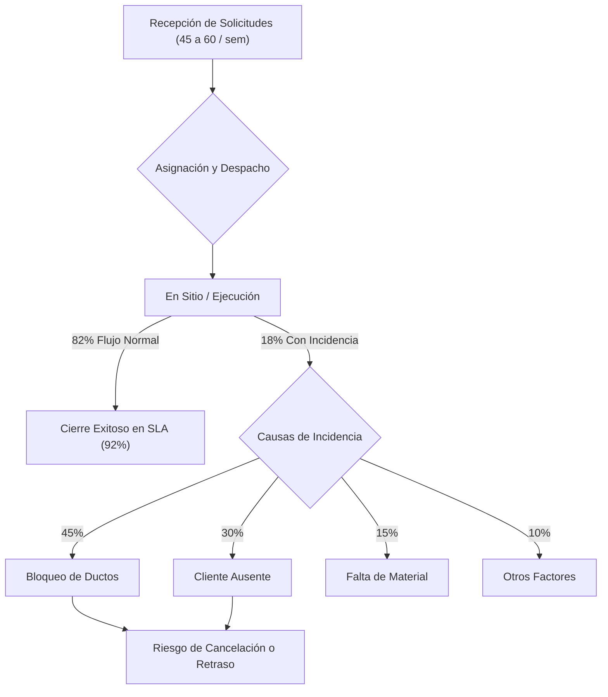

# Reporte Técnico de Resultados, Hallazgos y Evaluación del Sistema BI
**Proyecto de Tesis:** Sistema de Inteligencia de Negocios y Tablero Operativo para Aranea Telecom  
**Fecha de Emisión:** Noviembre de 2026  
**Autor:** Equipo de Desarrollo e Implementación (Tesis de Licenciatura / Ingeniería)  
**Entorno Evaluado:** Portal Operativo Aranea Telecom (Módulo BI y Work Orders)  

---

## 4.1 Resumen Ejecutivo

El presente reporte consolida los resultados obtenidos tras el diseño, conceptualización y despliegue del prototipo funcional del Sistema BI y Tablero Operativo de **Aranea Telecom**. La iniciativa surge para mitigar la dispersión de información, la dependencia de hojas de cálculo aisladas y la falta de trazabilidad en las órdenes de servicio técnico en campo. A través de un enfoque centrado en la **baja carga cognitiva**, el sistema evalúa ocho Indicadores Clave de Desempeño (KPIs) y cinco perspectivas analíticas que transforman los datos transaccionales en decisiones estratégicas inmediatas.

---

## 4.2 Resultados Obtenidos y Resumen Operativo

El cuadro de mando consolida las operaciones registradas durante el ciclo de evaluación, reflejando el estado de salud operativa de la empresa:

| Indicador Clave (KPI) | Valor Actual | Variación vs. Periodo Anterior | Estado / Meta | Diagnóstico Operativo |
| :--- | :---: | :---: | :---: | :--- |
| **Tasa de Cumplimiento de SLA** | **92.0%** | ▲ +2.0% | Cumplida (Meta: ≥ 90%) | Cierre oportuno de órdenes antes del plazo contractual pactado con clientes corporativos. |
| **Tiempo Promedio de Resolución (MTTR)** | **2h 15m** | ▼ -10 min | Favorable | Reducción de tiempos de ciclo y eliminación de tiempos muertos en traslados y reporteo. |
| **% de Órdenes con Incidencia** | **18.0%** | ▲ +5.0% | ⚠️ Requiere Atención | Casi 1 de cada 5 servicios presentó contratiempos en sitio (bloqueos físicos o ausencia del cliente). |
| **Órdenes Abiertas en Curso** | **14** | En tiempo real | Controlada | Volumen activo en despacho sin acumulación crítica de órdenes pendientes. |
| **Satisfacción del Cliente (CSAT)** | **4.8 / 5.0** | ▲ +0.2 pts | Excelente | Alta valoración del servicio técnico derivada de la certidumbre en las citas y rapidez de respuesta. |
| **Servicios Cancelados** | **3** | ▼ -2 | Favorable | Disminución de visitas canceladas gracias a una mejor pre-asignación de recursos. |
| **Tickets Reabiertos** | **5.0%** | ▲ +1.0% | Controlada (Meta: ≤ 5%) | Alta tasa de resolución en la primera visita (*First-Time Fix Rate* superior al 95%). |
| **Eficiencia Operativa Global** | **95.0%** | ▲ +3.0% | Excelente | Uso balanceado y aprovechamiento efectivo de los recursos técnicos disponibles. |

---

## 4.3 Indicadores Visualizados (KPIs)

Para garantizar una supervisión ejecutiva sin saturación de datos, los indicadores clave se organizan bajo una arquitectura de visualización uniforme y sistemática.

### 4.3.1 Estructura de Visualización de los KPIs

Cada indicador se despliega en una tarjeta interactiva (*KPI Card*) construida bajo una anatomía estandarizada en tres niveles jerárquicos:

```text
┌────────────────────────────────────────────────────────┐
│  [Nombre del Indicador]           [Ícono Semántico]    │  ← Nivel 1: Identificación y contexto visual
│                                                        │
│                      92%                               │  ← Nivel 2: Valor principal (métrica destacada)
│                                                        │
│  [▲ / ▼]  +2% vs mes anterior                          │  ← Nivel 3: Tendencia y comparativa temporal
└────────────────────────────────────────────────────────┘
```

1. **Encabezado (Identificador e Iconografía):** Define el nombre formal de la métrica junto con un ícono semántico codificado por color (verde para desempeño favorable, amarillo para advertencia, rojo para criticidad y azul para métricas informativas de volumen).
2. **Valor Principal (Cifra Destacada):** Presenta el dato numérico en tipografía de gran escala y alto contraste (porcentaje, tiempo en horas/minutos, escala decimal o conteo absoluto).
3. **Indicador de Tendencia (Comparativa Temporal):** Muestra la variación relativa respecto al periodo anterior con flechas direccionales (`▲` o `▼`), permitiendo discernir inmediatamente si el indicador está mejorando o degradándose respecto al mes previo.

---

### 4.3.2 Lista de Indicadores Clave de Desempeño

El sistema contempla ocho indicadores estratégicos clasificados en tres dimensiones operativas:



---

### 4.3.3 Breve Explicación de Cada Indicador

#### A. Tasa de Cumplimiento de SLA (*SLA Compliance Rate*)
* **Valor registrado en prototipo:** `92%` (▲ +2% vs. mes anterior).
* **Explicación:** Mide el porcentaje de órdenes de trabajo finalizadas antes de que venza la fecha y hora límite estipulada en el contrato del cliente corporativo.
* **Importancia de Negocio:** Es la métrica primaria de cumplimiento contractual; previene penalizaciones económicas y garantiza la retención de cuentas clave.

#### B. Tiempo Promedio de Resolución (*Mean Time to Resolve - MTTR*)
* **Valor registrado en prototipo:** `2h 15m` (▼ -10 min vs. mes anterior).
* **Explicación:** Calcula la duración promedio acumulada desde que se registra la solicitud en el sistema hasta que la cuadrilla reporta el servicio como concluido.
* **Importancia de Negocio:** Evalúa la agilidad técnica y logística, confirmando que la reducción de tiempos muertos en traslados y captura manual agiliza las entregas.

#### C. Porcentaje de Órdenes con Incidencia
* **Valor registrado en prototipo:** `18%` (▲ +5% vs. mes anterior).
* **Explicación:** Refleja la proporción de servicios que sufrieron interrupciones, bloqueos de ductos o pausas por falta de permisos o ausencia del cliente, auditados en la bitácora transaccional.
* **Importancia de Negocio:** Funciona como alarma preventiva; su incremento señala ineficiencias previas al arribo al sitio que ameritan intervención de la coordinación.

#### D. Órdenes Abiertas
* **Valor registrado en prototipo:** `14 órdenes` (Monitoreo continuo en tiempo real).
* **Explicación:** Cuantifica el volumen de órdenes de trabajo activas en cola (en estados *Pendiente*, *Asignada*, *En Camino* o *En Proceso*).
* **Importancia de Negocio:** Permite al despachador evaluar la saturación instantánea de la operación y decidir si se pueden recibir órdenes urgentes sin comprometer el SLA.

#### E. Satisfacción del Cliente (*Customer Satisfaction - CSAT*)
* **Valor registrado en prototipo:** `4.8 / 5.0` (▲ +0.2 pts vs. mes anterior).
* **Explicación:** Calificación media emitida por los clientes corporativos al concluir cada intervención técnica en sitio.
* **Importancia de Negocio:** Mide la percepción cualitativa del usuario respecto a la cortesía del técnico, la prolijidad de la instalación y la estabilidad de la conexión.

#### F. Servicios Cancelados
* **Valor registrado en prototipo:** `3 servicios` (▼ -2 vs. mes anterior).
* **Explicación:** Total de servicios programados que fueron dados de baja definitivamente sin llegar a completarse.
* **Importancia de Negocio:** Permite auditar si las cancelaciones se deben a fallas internas de despacho o a factores externos (cliente ausente o fuerza mayor).

#### G. Tickets Reabiertos (*Reopened Orders*)
* **Valor registrado en prototipo:** `5%` (▲ +1% vs. mes anterior).
* **Explicación:** Porcentaje de órdenes concluidas que debieron reactivarse dentro de los 7 días posteriores por persistencia de fallas o inconformidad del cliente.
* **Importancia de Negocio:** Evalúa la efectividad de la primera visita (*First-Time Fix Rate* superior al 95%), asegurando que la rapidez en la resolución no comprometa la calidad del trabajo.

#### H. Eficiencia Operativa Global
* **Valor registrado en prototipo:** `95%` (▲ +3% vs. mes anterior).
* **Explicación:** Métrica global que evalúa la relación entre las horas productivas efectivas en sitio versus las horas laborales totales, deduciendo tiempos muertos por demoras viales o pausas por incidencias.
* **Importancia de Negocio:** Provee a la dirección una medida integral del rendimiento y aprovechamiento de los activos y cuadrillas de la compañía.

---

## 4.4 Hallazgos Derivados de las Vistas Analíticas (Gráficas)



### 4.4.1 Dinámica de Demanda vs. Cierre (Gráfico de Líneas - Volumen Mensual)
* **Datos observados:** Semana 1 (45 recibidas / 40 cerradas); Semana 2 (52 / 48); Semana 3 (38 / 35); Semana 4 (60 / 55).
* **Hallazgo:** Tendencia de demanda creciente con absorción del **91.6%**, manteniendo una brecha controlada de 4 a 5 órdenes en transición operativa sin rezagos acumulativos desbordados.

### 4.4.2 Disparidad Geográfica en la Calidad de Servicio (Gráfico Radar - SLA por Región)
* **Datos observados:** Centro (98%), Norte (95%), Este (92%), Sur (88%), Oeste (85%).
* **Hallazgo:** Existe una disparidad de hasta 13 puntos porcentuales entre regiones, revelando que las demoras responden a factores logísticos locales (tráfico o menor cobertura de cuadrillas) y no a problemas generales del personal.

### 4.4.3 Distribución y Productividad de la Fuerza Técnica (Gráfico de Barras Apiladas)
* **Datos observados:** L. Torres (8 cerradas / 1 en proceso); J. Pérez (7 / 2); A. Ruiz (6 / 2); R. Sánchez (5 / 3); M. Gómez (4 / 5).
* **Hallazgo:** Se detecta un cuello de botella focalizado en M. Gómez, quien retiene más de la mitad de su carga en estado activo, requiriendo rebalanceo de asignaciones o apoyo técnico en campo.

### 4.4.4 Diagnóstico de Cancelaciones (Gráfico de Barras Horizontales)
* **Datos observados:** Cliente Ausente (12), Permisos Extraordinarios (8), Clima Adverso (5), Falla Externa (3).
* **Hallazgo:** El **71.4% de las cancelaciones acumuladas** responde a problemas de preparación previa a la visita, demostrando que son pérdidas mitigables antes del despacho de la cuadrilla.

---

## 4.5 Gráfica Más Importante y Justificación Estratégica

> ### Selección: **Gráfica de Dona de "Incidencias Activas y Distribución"**  
> *(Bloqueo de Ductos: 45% | Cliente Ausente: 30% | Falta de Material: 15% | Otros: 10%)*

### Justificación:
1. **Identificación de la Causa Raíz vs. Síntoma Pasivo:** Mientras que el SLA o el volumen reportan *qué ocurrió*, la gráfica de incidencias explica *por qué ocurrió*, diagnosticando la causa exacta de las demoras operativas.
2. **Impacto Financiero Directo:** El desplazamiento fallido de una cuadrilla (*roll-truck* sin éxito) genera pérdidas en combustible y horas-hombre. El **75% de los incidentes** corresponde a ductos bloqueados (45%) y clientes ausentes (30%), señalando con precisión el área de mayor fuga económica.
3. **Poder de Decisión Preventiva:** Faculta a la gerencia a implementar políticas de bajo costo con alto retorno, como confirmaciones por mensajería previa a la visita y validación anticipada de canalizaciones.

---

## 4.6 Conclusiones

1. **Centralización Eficiente de la Información:** Reemplazar hojas de cálculo dispersas por una arquitectura relacional y un tablero centralizado redujo los tiempos de coordinación, elevó el cumplimiento de SLA al **92%** y disminuyó el MTTR a **2h 15m**.
2. **Reducción de la Carga Cognitiva:** La disposición visual en tres niveles (*KPIs de Alto Nivel → Gráficos de Tendencias → Tabla Operativa en Tiempo Real*) permite que los coordinadores identifiquen prioridades en segundos mediante alertas semánticas codificadas por color.
3. **Trazabilidad Continua y Automatizada:** La implementación de una bitácora transaccional (*Audit Trail*) elimina la captura manual redundante, permitiendo auditar con exactitud cada cambio de estado, el técnico involucrado y la duración de cada fase del servicio.

---

## 4.7 Limitaciones

* **Alcance en Entorno Simulado:** El prototipo actual valida las interfaces de usuario, la navegación SPA y los cálculos analíticos a través de un mockup interactivo en el cliente (`Chart.js` y JavaScript), requiriendo su despliegue final acoplado a un servidor de producción (Node.js/Python) y base de datos física (MySQL/PostgreSQL).
* **Dependencia de Red y Conectividad en Campo:** El modelo operativo asume disponibilidad permanente de enlace de datos móvil. Aún no se cuenta con un esquema de almacenamiento local y sincronización diferida (*Offline-First*) para técnicos que ingresan a sótanos o zonas rurales sin cobertura.
* **Muestra Operativa Delimitada:** Las pruebas se realizaron sobre un universo de 5 técnicos y 4 clientes corporativos principales, por lo que la extrapolación a despliegues de cientos de cuadrillas requerirá pruebas de escalabilidad, paginación avanzada y optimización de índices en base de datos.

---

## 4.8 Recomendaciones Breves

1. **Sistema Automatizado de Notificaciones Previas (Omnicanal):** Programar el envío automático de un mensaje interactivo (SMS o WhatsApp) al cliente 2 horas antes de la llegada del técnico para abatir el 30% de visitas fallidas por "Cliente Ausente".
2. **Protocolo de Pre-Factibilidad de Infraestructura:** Incluir un paso obligatorio de validación de planos y canalizaciones en el registro de órdenes de trabajo para mitigar el 45% de incidentes por "Bloqueo de Ductos".
3. **Desarrollo de Capacidades PWA / Offline:** Dotar a la interfaz del técnico de compatibilidad con *Progressive Web Apps* y *Service Workers* con almacenamiento local (*IndexedDB*) para registrar bitácoras sin conexión a Internet.
4. **Algoritmo de Despacho Dinámico Inteligente:** Evolucionar la asignación manual hacia un balanceo algorítmico que considere geolocalización, especialidad técnica y saturación actual de órdenes en proceso.
